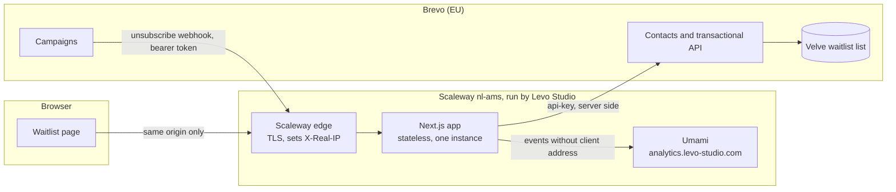
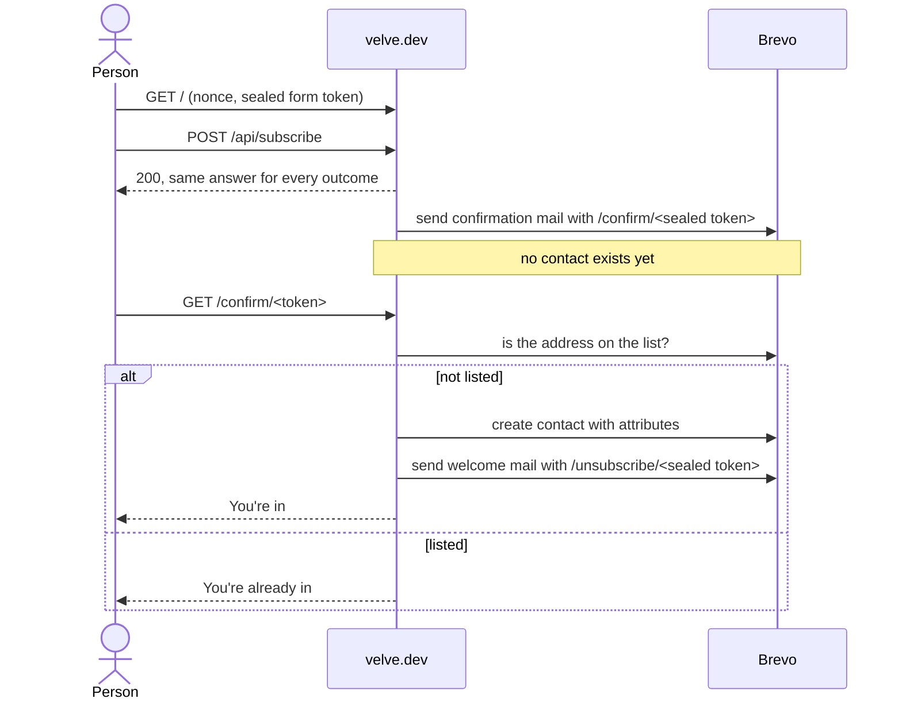
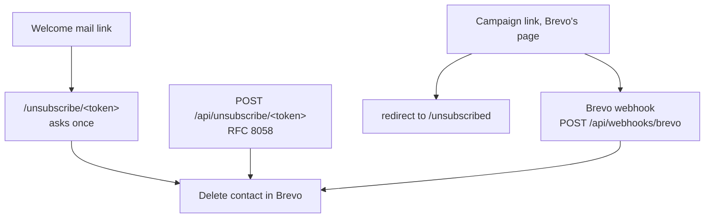

# Architecture

## Components and trust boundaries

The browser only ever talks to `velve.dev`. Brevo and Umami are reached from the server. The app keeps nothing on disk. Its only state is the in-memory limiters, which reset on restart.

## Sign-up and confirmation

## Leaving the list

## Tokens

All link tokens are AES-256-GCM with `TOKEN_KEY`, a random 12-byte IV and the purpose (`confirm`, `unsubscribe`, `form`) as additional authenticated data, so a token for one purpose cannot be used for another. They are base64url in the path, which keeps addresses out of access logs. Confirmation tokens expire after `CONFIRM_TOKEN_TTL_SECONDS`. Unsubscribe tokens do not expire.
